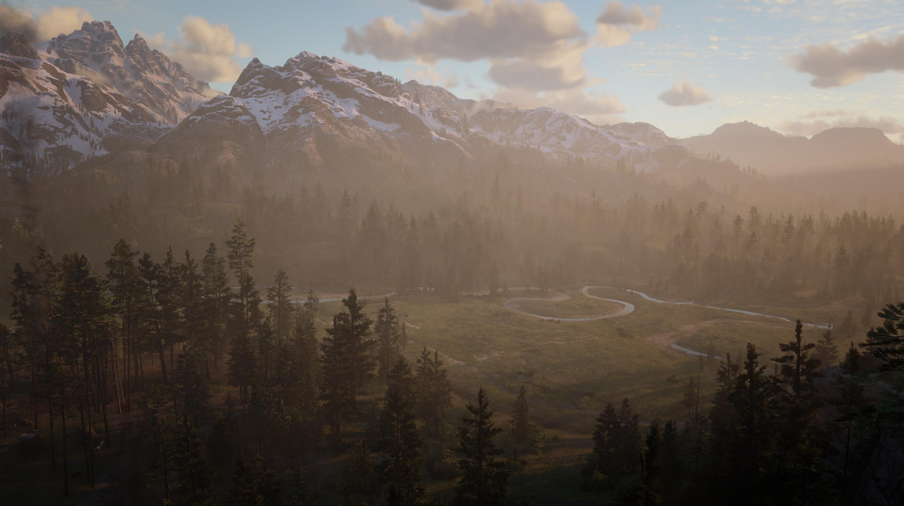

# Elsewhere in Frames

A personal game photography site by Aryan Sharma. It collects screenshots I take while exploring video game worlds.

## View the site

Open `index.html` in a browser. The site is plain HTML and CSS, with no build step or dependencies.

## What is here

- A featured Red Dead Redemption 2 photograph, stored locally in `assets/featured-frame.jpeg`
- A homepage with selected worlds and a link to the full catalogue
- Seventeen individual game pages with palettes inspired by their settings
- 177 photographs from 17 games, with smaller previews and larger viewing links
- Dedicated pages for new additions, including Ghost of Tsushima, Batman: Arkham Knight, and Marvel’s Spider-Man: Miles Morales

The layout adapts to desktop and mobile screens. Navigation works with a keyboard, images have descriptive text, and reduced-motion preferences are respected.

## Project files

- `index.html` — homepage content and metadata
- `catalogue.html` — the complete list of game worlds
- `games/` — individual game pages
- `style.css` — shared layout and typography
- `games.css` — catalogue, game page, and theme styles
- `scripts/generate-pages.mjs` — source for the catalogue and game pages
- `scripts/import-screenshots.ps1` — imports an archive of screenshots and prepares web sized copies
- `assets/screenshots/manifest.json` — image lists used to build the galleries
- `assets/screenshots/` — full size images and gallery previews
- `assets/featured-frame.jpeg` — original in-game capture

All photographs featured on the site are captured by Aryan Sharma.

## Updating the collection

Edit the game details in `scripts/generate-pages.mjs`, then run `node scripts/generate-pages.mjs` from the project root to refresh the catalogue and game pages. To import a new archive, run `./scripts/import-screenshots.ps1 -ArchivePath "C:\path\to\screenshots.zip"` first. The generated HTML is checked in, so viewing the site never requires Node.
